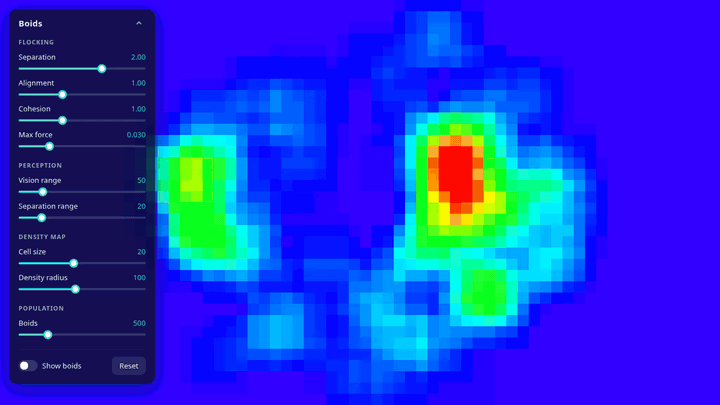
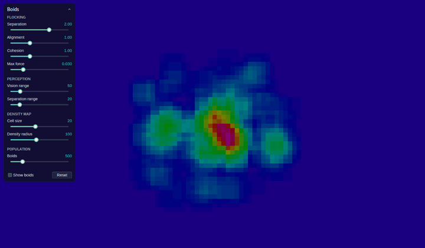

# Flocking Simulation with Boids (Scala 3)

A Scala 3 flocking simulation based on Craig Reynolds' Boids algorithm. It is cross-compiled to run both as a desktop app on the **JVM** (Java Swing) and in the **browser** (Scala.js + p5.js).

**[▶ Try the live demo](https://cric96.github.io/scala-boids/)**

| Web (Scala.js + p5.js) | JVM (Swing + FlatLaf) |
| :---: | :---: |
|  |  |

---

## ⚡ Quick Start

Use the included quick launcher script to run either version easily.

```bash
# Set execute permissions (first time only)
chmod +x launch.sh

# Run the interactive menu, or specify "jvm" or "js" directly
./launch.sh
```

---

## 💻 Running the JVM Version Manually

If you prefer to use `sbt` directly, run:

### 1. Interactive Swing Simulation
```bash
sbt "boids/runMain it.unibo.FlockingRendering"
```

### 2. Headless Simulation & JSON Export
```bash
sbt "boids/runMain it.unibo.core.main --boids 500 --separation 1.5 --align 1.0 --cohesion 1.0 --separation-range 20 --vision 50 --width 800 --height 600 --seeds 5"
```

### 3. Reproduce from Exported JSON
```bash
sbt "boids/runMain it.unibo.core.reproduce res/<seed>"
```

---

## 🌐 Running the Web Version Manually

The web version is bundled with [Vite](https://vite.dev) through the official [`@scala-js/vite-plugin-scalajs`](https://github.com/scala-js/vite-plugin-scalajs) (requires Node.js 20.19+):

```bash
cd boids/js
npm install
npm run dev
```

The dev server links Scala.js with sbt on startup; run `sbt ~boidsJS/fastLinkJS` in another terminal to recompile on every change.

To build the static site deployed on GitHub Pages, run `npm run build` (output in `boids/js/dist`, preview it with `npm run preview`).

---

## 🎛️ Parameters

The slider ranges and defaults, and the simulation constants (speed cap, neighbours per boid), live in [`boids/shared/src/main/resources/parameters.json`](boids/shared/src/main/resources/parameters.json). sbt embeds the file at build time, so the JVM and the web version always share the same settings: edit it and rebuild.

---

## ⏱️ Benchmark

Time a simulation step and the density map for a given number of boids, after as many warm-up steps as measured ones:
```bash
sbt "boids/Test/runMain it.unibo.benchmark 5000 300"
```

---

## 🧹 Code Formatting

Format all Scala sources with Scalafmt:
```bash
sbt scalafmtAll
```
